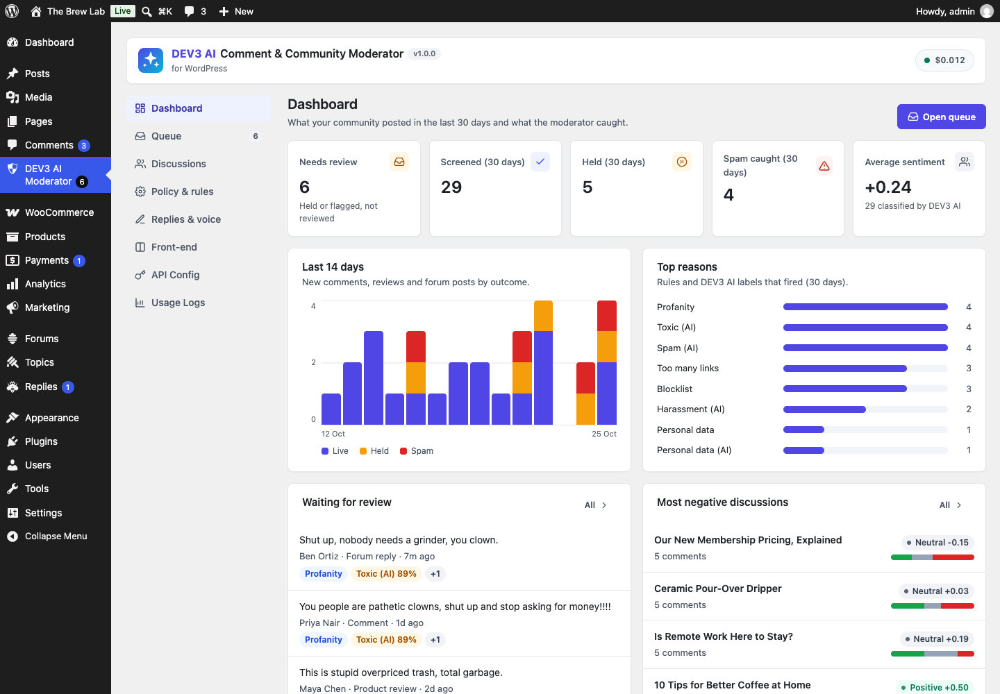

# DEV3 AI Comment & Community Moderator for WordPress

AI moderation for WordPress comments, WooCommerce reviews and bbPress replies: rule screening, toxicity and spam classification, a moderation queue, reply drafts, thread summaries and sentiment.



## Features

DEV3 AI Comment & Community Moderator keeps your discussions healthy without hiding anything by accident.

* **Rule screen (no AI, no network):** links, blocklist, posting rate, cross-post duplicates, personal data (emails, phone and card numbers), profanity and Akismet verdicts. Each rule can flag, hold or spam.
* **DEV3 AI classification:** spam, toxicity, harassment, off-topic and personal data scores with a plain-language reason. A policy matrix (threshold + action per label) decides. The plugin only ever holds or spams: it never approves and never deletes.
* **One moderation queue** for comments, WooCommerce product reviews and bbPress topics and replies, with reasons, scores, history, bulk actions and CSV export.
* **Replies:** templates that work without AI, plus brand-voice reply drafts from DEV3 AI that you review before posting.
* **Discussions:** per-post sentiment (AI or a built-in lexicon), frequent words, and AI thread summaries with themes, open questions and follow-ups. Show approved summaries on the site with a block, a shortcode or automatically.
* **"Be kind" nudge:** before a visitor posts something hurtful, a gentle prompt lets them edit. Works locally in the browser; optionally asks DEV3 AI and offers kinder wording.
* **Scanner** for existing content, **policy tester**, GDPR export/erase, retention.

Works with AI off or without an API key. AI uses your own Google AI key, which stays on the server.

## Requirements

- WordPress 6.0 or newer (tested up to 6.8)
- PHP 7.4 or newer
- Optional: your own Google AI API key (from Google AI Studio) to switch on the DEV3 AI features. The rest of the plugin works without one.

## Installation

### From the release zip

1. Download `dev3-ai-comment-moderator.zip` from the [latest release](https://github.com/dev3tech/dev3-ai-comment-moderator/releases/latest).
2. In WordPress, go to **Plugins → Add New → Upload Plugin**, choose the zip and click **Install Now**.
3. Click **Activate**.

### Build from source

```bash
git clone https://github.com/dev3tech/dev3-ai-comment-moderator.git
cd dev3-ai-comment-moderator
composer install --no-dev
npm ci
npm run build
```

Then copy the `dev3-ai-comment-moderator` folder into `wp-content/plugins/` and activate it.

### Getting started

1. Upload the zip in Plugins → Add New → Upload Plugin and activate it.
2. Open **DEV3 AI Moderator**. Rules work immediately.
3. Optional: add a Google AI API key under API Config to turn on DEV3 AI.
4. Optional: run Policy & rules → Scan existing content.

## FAQ

### Does the AI ever delete or approve comments?
No. It can only move content to held or spam, per your policy. Items a moderator reviewed are never moved again.

### Does it replace Akismet?
It works next to Akismet: Akismet's spam verdicts are respected and shown as a reason.

### Will visitors wait for the AI?
In "before publishing" mode the check waits up to the timeout (default 8 s) and falls back to the rules; the AI then retries in the background. "Background" mode never makes visitors wait.

### What data is sent to Google?
Only the text of the item being checked, the post title/excerpt and (for replies) the parent comment. Turn on PII masking in API Config to mask emails and phone numbers first.

## Privacy

Moderation records store the author name and email and a hashed IP. They are included in WordPress personal data export and erase requests and pruned after the retention period. With DEV3 AI on, the checked text is sent to Google AI under your API key.

## Documentation

The full HTML guide (installation, settings, hooks and FAQ) is in [`docs/index.html`](docs/index.html). Open it in a browser after cloning or downloading the repository.

## Changelog

### 1.0.0
* Initial release.

## Licence

Released under the GNU General Public License v2.0 or later (GPL-2.0-or-later). See [LICENSE](LICENSE).

## More from DEV3

- [DEV3 AI Comment & Community Moderator for WordPress on the DEV3 Marketplace](https://www.dev3.tech/item/dev3-ai-comment-moderator)
- [More WordPress plugins, themes and templates from DEV3](https://www.dev3.tech/marketplace)
